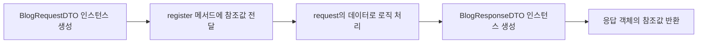
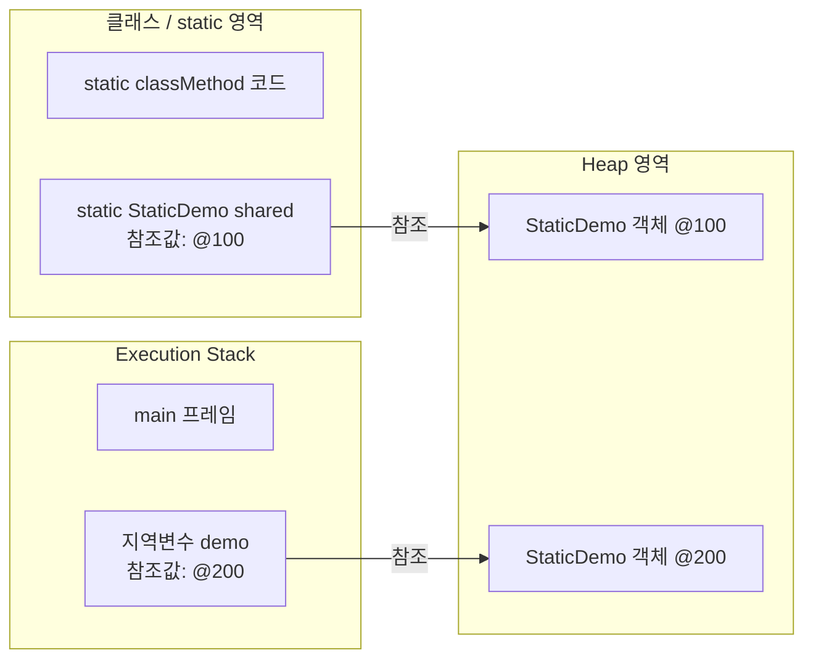
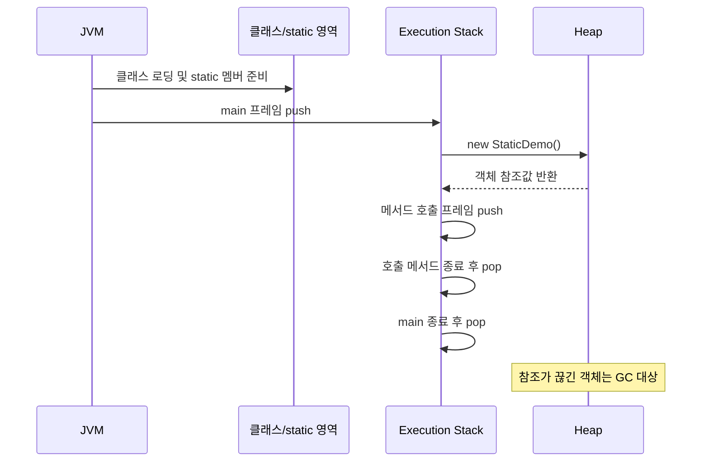

# BE 2일차 — Java 핵심 문법

## 오늘 배운 내용

- 객체를 매개변수와 반환값으로 사용하는 방법
- DTO와 `has-a` 관계
- 메서드 오버로딩
- `static`, 인스턴스, JVM 메모리 구조
- 연산자와 조건문
- `for`, `while`, `do-while` 반복문
- `String` 비교와 문자열의 불변성
- `Scanner`를 이용한 콘솔 입력
- 배운 문법을 활용한 숫자 맞히기 게임

---

## 1. 클래스, 인스턴스와 `has-a` 관계

클래스는 객체를 만들기 위한 설계도이며, 클래스로부터 생성된 실제 객체를 **인스턴스**라고 한다.

```java
StaticDemo demo = new StaticDemo();
```

- `StaticDemo`: 클래스 또는 참조 타입
- `new StaticDemo()`: Heap 영역에 인스턴스 생성
- `demo`: 생성된 인스턴스를 가리키는 참조 변수

한 클래스가 다른 클래스 타입의 필드를 가지는 관계를 `has-a` 관계라고 한다.

```java
class Blog {
    Writer writer;
}
```

위 구조는 “Blog가 Writer를 가지고 있다”라고 표현할 수 있다.

---

## 2. DTO와 객체 전달

DTO(Data Transfer Object)는 여러 데이터를 하나의 객체로 묶어서 전달하기 위해 사용한다.

- `BlogRequestDTO`: 사용자가 서버에 보내는 요청 정보
- `BlogResponseDTO`: 서버가 사용자에게 돌려주는 응답 정보
- JSON 객체 하나를 Java DTO 객체 하나로 변환할 수 있다.

```java
BlogRequestDTO request = new BlogRequestDTO(
    1,
    "오늘도 무사히",
    "내용",
    "tjwjddns1302@gmail.com"
);
```

메서드의 매개변수와 반환 타입에는 기본 타입뿐 아니라 객체 타입도 사용할 수 있다.

```java
public BlogResponseDTO register(BlogRequestDTO request) {
    if ("tjwjddns1302@gmail.com".equals(request.getEmail())) {
        return new BlogResponseDTO(201, "OK");
    }

    return new BlogResponseDTO(400, "FAIL");
}
```

호출 흐름은 다음과 같다.



> Java에서 객체를 매개변수로 전달하거나 반환한다는 것은 실제 객체 전체가 이동하는 것이 아니라 객체를 가리키는 참조값이 전달되는 것으로 이해하면 된다.

---

## 3. 메서드 오버로딩

하나의 클래스 안에 이름이 같은 메서드를 여러 개 선언할 수 있다. 이를 **메서드 오버로딩**이라고 한다.

```java
public BlogResponseDTO register(
    String title,
    String content,
    String email
) {
    // 로직
}

public BlogResponseDTO register(BlogRequestDTO request) {
    // 로직
}
```

오버로딩이 성립하려면 매개변수의 **개수, 타입 또는 순서**가 달라야 한다. 반환 타입만 다른 메서드는 오버로딩할 수 없다.

---

## 4. `static`과 인스턴스

### 인스턴스 멤버

인스턴스 변수와 인스턴스 메서드는 생성된 객체의 소유다.

```java
public String message = "인스턴스";

public void nonStaticMethod() {
    System.out.println(message);
}
```

따라서 인스턴스를 먼저 생성한 후 접근한다.

```java
StaticDemo demo = new StaticDemo();
System.out.println(demo.message);
demo.nonStaticMethod();
```

### static 멤버

`static` 변수와 메서드는 특정 인스턴스가 아니라 **클래스의 소유**다.

```java
public static String staticMessage = "클래스 소유";

public static void classMethod() {
    System.out.println(staticMessage);
}
```

객체를 만들지 않고 클래스 이름으로 접근한다.

```java
System.out.println(StaticDemo.staticMessage);
StaticDemo.classMethod();
```

### static에서 인스턴스 멤버에 바로 접근할 수 없는 이유

```java
public static void classMethod() {
    System.out.println(message); // 컴파일 오류
}
```

static 메서드는 인스턴스가 없어도 호출할 수 있다. 반면 `message`는 인스턴스마다 별도로 존재한다. 따라서 JVM은 어느 인스턴스의 `message`에 접근해야 하는지 알 수 없다.

static 메서드에는 현재 인스턴스를 가리키는 `this`도 존재하지 않는다. 인스턴스 멤버에 접근하려면 객체의 참조를 명시적으로 확보해야 한다.

```java
public static void classMethod() {
    StaticDemo demo = new StaticDemo();
    System.out.println(demo.message);
}
```

### static과 인스턴스의 메모리 연결



핵심은 다음과 같다.

- 인스턴스 자체는 `new`에 의해 Heap 영역에 생성된다.
- static 참조 변수는 Heap 객체의 참조값을 가질 수 있다.
- static 메서드 안의 지역변수는 실행 중 Stack 프레임에 저장된다.
- static 영역이나 Stack에는 인스턴스 자체가 아니라 인스턴스를 가리키는 참조값이 저장된다.

```java
// static 참조 변수가 Heap 인스턴스를 계속 참조
public static StaticDemo shared = new StaticDemo();

// static 메서드의 지역변수가 실행 중에만 Heap 인스턴스를 참조
public static void run() {
    StaticDemo demo = new StaticDemo();
}
```

---

## 5. JVM 메모리와 실행 흐름

학습 단계에서는 JVM 메모리를 다음과 같이 나누어 이해할 수 있다.

- 클래스/static 영역: 클래스 정보, static 변수, 메서드 코드
- Execution Stack: 실행 중인 메서드 프레임과 지역변수
- Heap: `new`로 생성한 인스턴스
- String Pool: 문자열 리터럴을 재사용하기 위한 공간



`main()`은 static 메서드이므로 인스턴스 생성 없이 JVM이 호출할 수 있다. `main()`이 호출되면 실행 정보가 Stack에 쌓이고, 일반적인 단일 실행 흐름에서는 `main()`이 끝나 Stack에서 빠지면 프로그램 실행도 종료된다.

Heap의 인스턴스와 연결된 참조가 모두 사라지면 해당 객체는 Garbage Collector가 정리할 수 있는 대상이 된다. GC 대상이 되었다고 즉시 삭제되는 것은 아니며, 실제 정리 시점은 JVM이 결정한다.

---

## 6. `final`과 상수

`final` 변수는 한 번 초기화한 후 값을 다시 변경할 수 없다.

```java
public static final double PI = 3.14;
```

- `static`: 클래스가 공유
- `final`: 값 변경 불가
- `static final`: 모든 인스턴스가 공유하는 상수

상수 이름은 일반적으로 대문자와 `_`를 사용한다.

```java
public static final int MAX_COUNT = 10;
```

---

## 7. 연산자

실습에서 확인한 주요 연산자는 다음과 같다.

| 종류 | 연산자 | 설명 |
| --- | --- | --- |
| 산술 | `+`, `-`, `*`, `/`, `%` | 사칙연산과 나머지 |
| 대입 | `=`, `+=`, `-=`, `*=`, `/=` | 값을 대입하거나 계산 후 대입 |
| 증감 | `++`, `--` | 값을 1 증가 또는 감소 |
| 비교 | `<`, `>`, `<=`, `>=`, `==`, `!=` | 두 값을 비교 |
| 논리 | `&&`, `\|\|`, `!` | AND, OR, NOT |
| 삼항 | `조건 ? 참 : 거짓` | 조건에 따라 값 선택 |

### 난수와 형변환

`Math.random()`은 `0.0 이상 1.0 미만`의 `double` 값을 반환한다.

```java
int number = (int) (Math.random() * 100) + 1;
```

위 코드는 `1 이상 100 이하`의 난수를 만든다. `(int)`는 `double` 값을 `int`로 바꾸는 명시적 형변환이다.

`Math.random()`은 static 메서드이므로 `Math` 인스턴스를 만들지 않고 클래스 이름으로 호출한다.

---

## 8. 조건문

### `if`, `else if`, `else`

```java
if (number == 1) {
    return "거짓";
} else if (number == 2) {
    return "거짓";
} else {
    return "진실";
}
```

### 삼항 연산자

```java
return number == 3 ? "진실" : "거짓";
```

삼항 연산자는 간단한 조건에 적합하다. 조건이 복잡하거나 중첩이 많아지면 `if` 또는 `switch`가 읽기 쉽다.

### `switch` 표현식

```java
return switch (number) {
    case 1, 2 -> "거짓";
    case 3 -> "진실";
    default -> "1~3 사이의 값을 입력하세요";
};
```

---

## 9. 반복문

### `for`

반복 횟수나 범위가 명확할 때 사용하기 좋다.

```java
int result = 0;

for (int i = start; i <= end; i++) {
    result += i;
}
```

### `while`

조건을 먼저 검사하고, 조건이 참인 동안 반복한다. 처음부터 조건이 거짓이면 한 번도 실행하지 않는다.

```java
int i = 1;

while (i <= number) {
    result += i;
    i++;
}
```

### `do-while`

코드를 먼저 실행한 뒤 조건을 검사하므로 최소 한 번 실행된다.

```java
int i = 1;

do {
    result += i;
    i++;
} while (i <= number);
```

### 반복문 비교

| 반복문 | 조건 검사 | 적합한 상황 |
| --- | --- | --- |
| `for` | 실행 전 | 반복 횟수나 범위가 명확함 |
| `while` | 실행 전 | 조건 중심으로 반복함 |
| `do-while` | 실행 후 | 최소 한 번 실행해야 함 |

### `break`, `continue`, label

- `break`: 가장 가까운 반복문을 즉시 종료
- `continue`: 현재 반복의 남은 코드를 건너뛰고 다음 반복 진행
- label: 중첩 반복문에서 제어할 바깥쪽 반복문을 지정

```java
outer:
for (int row = 2; row <= 9; row++) {
    for (int col = 1; col <= 9; col++) {
        if (row == 5) {
            break outer;
        }
    }
}
```

---

## 10. 반복문 실습

### 구구단

```java
public void gugudan() {
    for (int row = 2; row <= 9; row++) {
        for (int col = 1; col <= 9; col++) {
            System.out.printf(
                "%d*%d=%d\t",
                row,
                col,
                row * col
            );
        }
        System.out.println();
    }
}
```

`printf()`에서 사용하는 주요 형식 지정자는 다음과 같다.

- `%d`: 정수
- `%s`: 문자열
- `%f`: 실수
- `\t`: 탭
- `\n`: 줄바꿈

### 문자열 거꾸로 출력

```java
public void popstr(String str) {
    for (int index = str.length() - 1; index >= 0; index--) {
        System.out.print(str.charAt(index));
    }
}
```

문자열 인덱스는 `0`부터 시작하므로 마지막 글자의 인덱스는 `str.length() - 1`이다.

---

## 11. `String`

`String`은 클래스이므로 참조 타입이지만 문자열 리터럴 문법을 지원한다.

```java
String str = "lgcns";
```

### `==`와 `equals()`

```java
String str01 = new String("lgcns");
String str02 = new String("lgcns");

System.out.println(str01 == str02);      // false
System.out.println(str01.equals(str02)); // true
```

- `==`: 두 참조 변수가 같은 객체를 가리키는지 비교
- `equals()`: 두 문자열의 실제 내용을 비교

문자열의 내용을 비교할 때는 `equals()`를 사용해야 한다.

```java
if ("tjwjddns1302@gmail.com".equals(request.getEmail())) {
    // 이메일 내용이 같을 때
}
```

상수를 앞에 두면 `request.getEmail()`이 `null`이어도 `NullPointerException`이 발생하지 않는다.

### String Pool

문자열 리터럴은 같은 내용을 재사용할 수 있도록 String Pool에서 관리된다.

```java
String str01 = "lgcns";
String str02 = "lgcns";

System.out.println(str01 == str02); // 일반적으로 true
```

두 변수는 String Pool에 있는 같은 문자열 객체를 참조한다. 하지만 `new String()`은 Heap에 서로 다른 객체를 명시적으로 생성한다.

```java
String str01 = new String("lgcns");
String str02 = new String("lgcns");

System.out.println(str01 == str02); // false
```

`==` 결과에 의존하지 말고 문자열 내용 비교에는 항상 `equals()`를 사용하는 것이 중요하다.

### String의 불변성

`String`은 `final` 클래스로 선언되어 있으며 문자열 값은 불변이다. 문자열을 연결하면 기존 객체가 변경되는 것이 아니라 새로운 문자열 결과가 만들어진다.

```java
String str = "lgcns";
str = str + "!!";
```

문자열을 반복적으로 변경해야 한다면 `StringBuilder` 또는 `StringBuffer`를 사용한다. 
buffer를 쓰면 메모리 효율성을 증대시킬수 있다.

```java
StringBuilder builder = new StringBuilder("lgcns");
builder.append("!!");
builder.append("!!");

String result = builder.toString();
```

- `StringBuilder`: 일반적인 단일 스레드 상황에서 사용
- `StringBuffer`: 동기화가 필요한 멀티스레드 공유 상황에서 사용

---

## 12. `Scanner`와 콘솔 입력

```java
import java.util.Scanner;

Scanner scanner = new Scanner(System.in);
System.out.print("숫자를 입력하세요: ");
int guess = scanner.nextInt();
```

- `System.in`: 표준 입력
- `Scanner`: 입력값을 읽는 객체
- `nextInt()`: 입력된 값을 `int`로 읽음

반복문 안에서 매번 `Scanner`를 생성하기보다 게임을 시작할 때 한 번 생성하여 재사용하는 편이 좋다.

---

## 14. 오늘의 핵심 정리

1. `static` 멤버는 인스턴스가 아니라 클래스의 소유다.
2. 인스턴스는 Heap에 생성되고, 변수에는 인스턴스의 참조값이 저장된다.
3. static 메서드에서 인스턴스 멤버에 접근하려면 객체의 참조가 필요하다.
4. 객체는 메서드의 매개변수와 반환값으로 사용할 수 있다.
5. 같은 이름의 메서드는 매개변수 구성이 다르면 오버로딩할 수 있다.
6. `for`, `while`, `do-while`은 조건과 목적에 맞게 선택한다.
7. 문자열 내용 비교에는 `==`가 아니라 `equals()`를 사용한다.
8. `String`은 불변이므로 반복적인 문자열 변경에는 `StringBuilder` 등을 사용한다.
9. 반복문, 조건문, 난수, `Scanner`를 결합하면 숫자 맞히기 게임을 구현할 수 있다.

> 오늘 실습의 중심은 Java 문법을 각각 외우는 것이 아니라, 객체의 참조와 메모리 흐름을 이해한 뒤 조건문·반복문·문자열을 실제 로직으로 연결하는 것이다.
