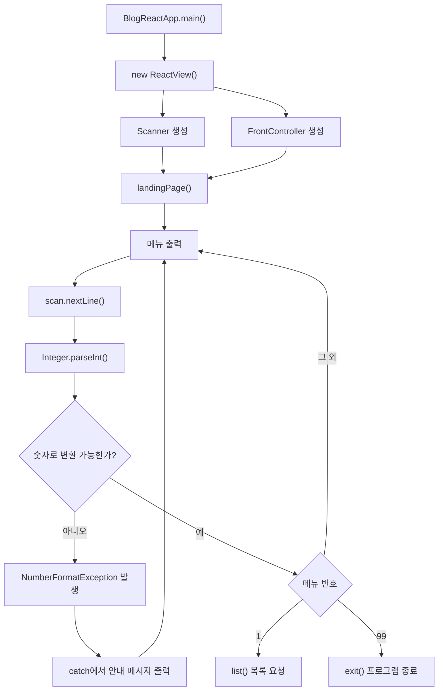
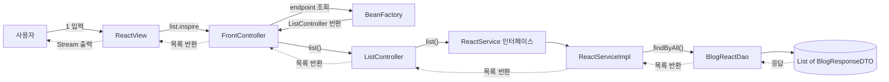
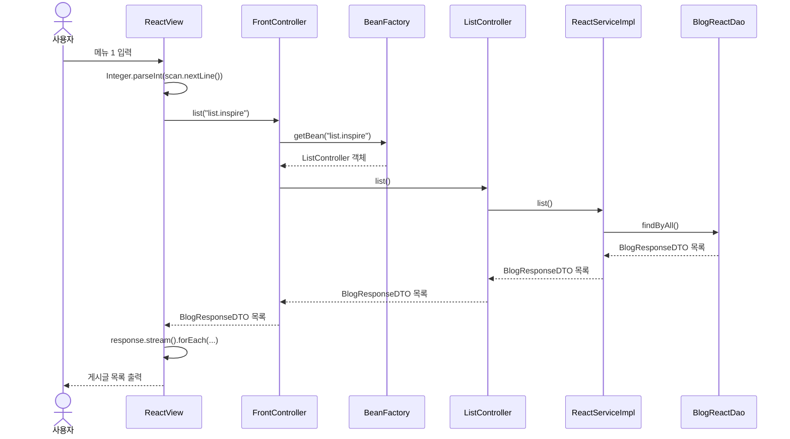
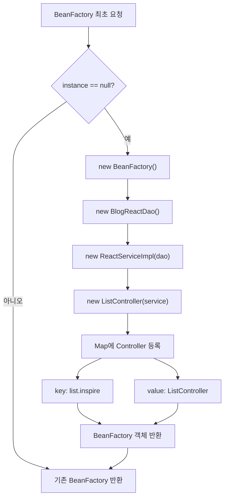
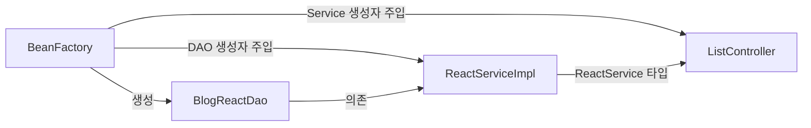
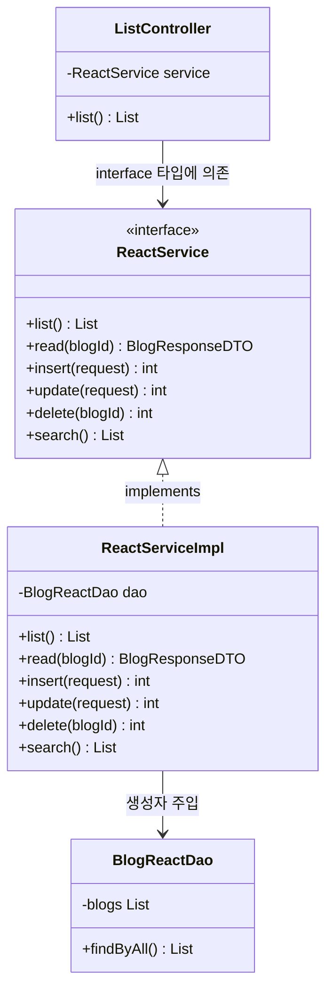
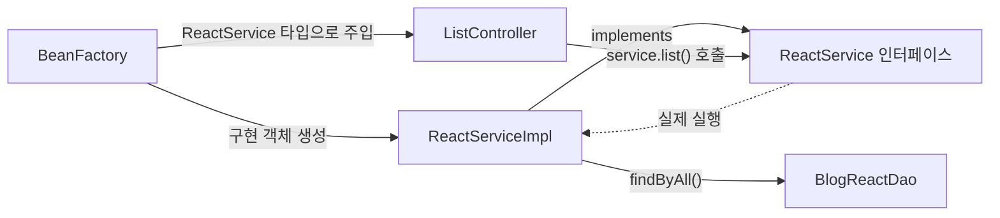
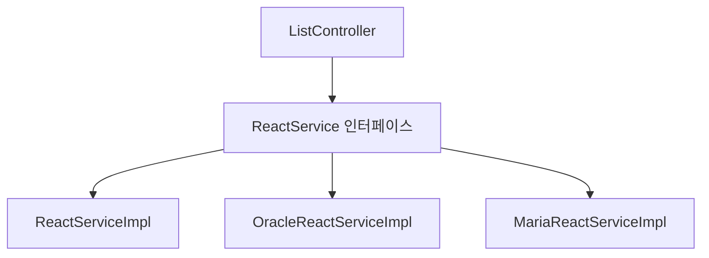
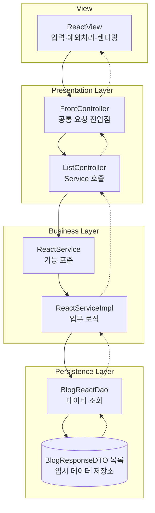
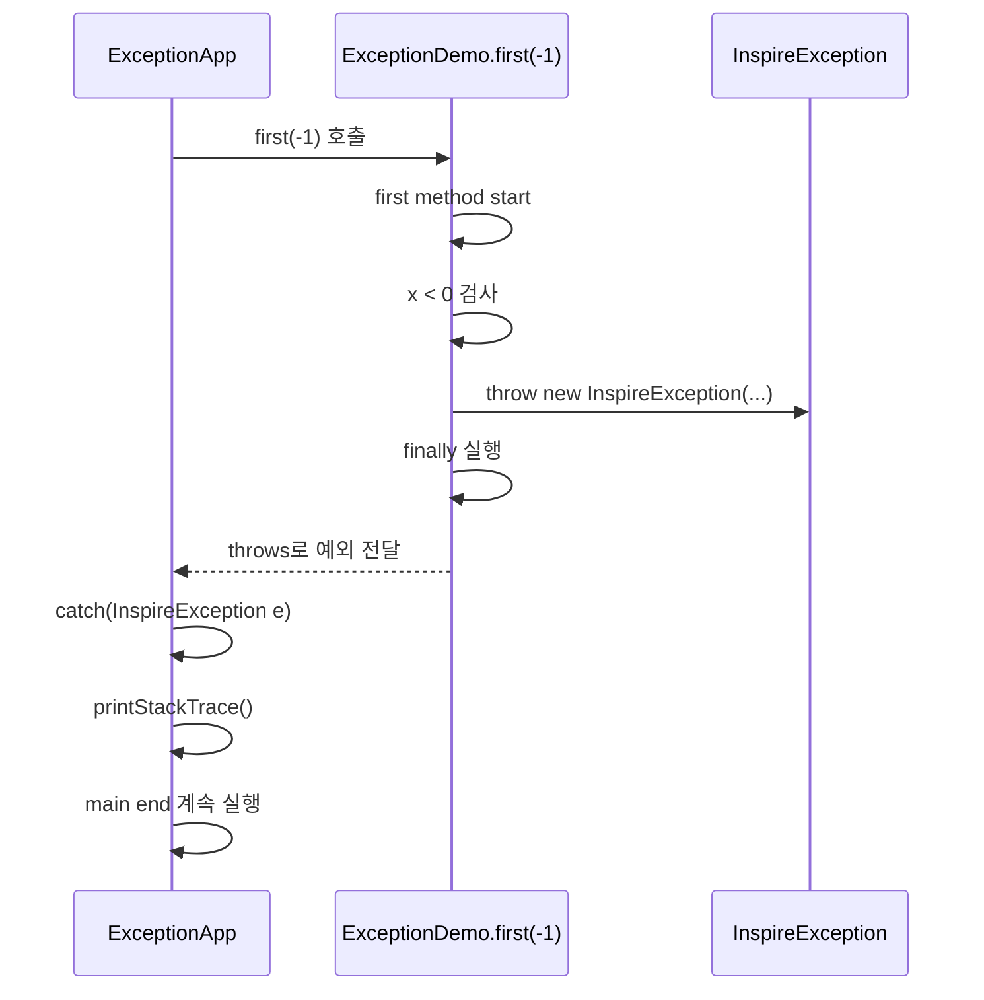

# BE 6일차 - 예외처리와 BlogReactApp 계층 흐름

## 1. 오늘의 전체 흐름

오늘 학습은 크게 두 부분으로 나뉜다.

```text
1. 예외처리
   → 예상하지 못한 입력과 실행 상황을 안전하게 처리

2. BlogReactApp
   → View부터 DAO까지 요청과 응답이 이동하는 계층 구조 구현
```

두 내용은 `ReactView`에서 하나로 연결된다.

```text
사용자 메뉴 입력
→ 문자열을 Integer로 변환
→ 잘못된 입력이면 예외처리 후 메뉴 재출력
→ 정상 입력이면 FrontController로 요청 전달
→ Controller → Service → DAO 실행
→ List<BlogResponseDTO> 응답
→ Stream으로 화면 출력
```

## 2. 오늘의 핵심 키워드

| 영역 | 핵심 키워드 | 역할 |
|---|---|---|
| 예외처리 | `try-catch-finally` | 예외를 잡고 처리하며 정리 작업 수행 |
| 예외처리 | `throw` | 코드에서 예외를 직접 발생시킴 |
| 예외처리 | `throws` | 메서드가 처리하지 않은 예외를 호출자에게 전달 |
| 예외처리 | Checked Exception | 컴파일러가 처리 또는 선언을 요구하는 예외 |
| 예외처리 | Unchecked Exception | `RuntimeException` 계열의 실행 중 예외 |
| 사용자 정의 예외 | `InspireException` | 업무 조건에 맞는 예외 의미 정의 |
| View | `ReactView` | 사용자 입력 및 결과 출력 |
| Front Controller | `FrontController` | 모든 요청의 공통 진입점 |
| Factory | `BeanFactory` | endpoint에 맞는 Controller 반환 |
| Controller | `ListController` | 요청을 받고 Service에 위임 |
| Service | `ReactService`, `ReactServiceImpl` | 비즈니스 로직 담당 |
| DAO | `BlogReactDao` | 데이터 저장 및 조회 담당 |
| DTO | `BlogResponseDTO` | 계층 사이의 응답 데이터 전달 |
| DI | 생성자 주입 | 객체가 필요한 의존 객체를 외부에서 전달받음 |
| Singleton | `BeanFactory.getInstance()` | Factory 객체를 하나만 생성하여 재사용 |
| Stream | `response.stream()` | 응답 목록을 화면에 반복 출력 |

## 3. 그림으로 보는 오늘의 전체 흐름

### 3.1 프로그램 시작과 입력 분기



핵심은 예외가 발생해도 애플리케이션 전체가 바로 종료되지 않고 `catch`에서 처리한 뒤 메뉴 입력으로 돌아간다는 점이다.

### 3.2 목록 조회 요청과 응답



- 실선: 요청이 안쪽 계층으로 이동
- 점선: 조회 결과가 View로 반환

### 3.3 메서드 단위 시퀀스



### 3.4 BeanFactory가 객체를 조립하는 과정



객체 의존 관계만 분리해서 보면 다음과 같다.



### 3.5 ReactService 인터페이스와 구현 관계



Java 문법으로는 다음 관계다.

```java
public interface ReactService {
    List<BlogResponseDTO> list();
}

public class ReactServiceImpl
        implements ReactService {

    @Override
    public List<BlogResponseDTO> list() {
        return dao.findByAll();
    }
}
```

`ReactServiceImpl`이 `ReactService`의 기능 명세를 물려받는다고 표현할 수 있지만, Java 문법상 클래스 상속인 `extends`가 아니라 인터페이스 구현인 `implements`다.

```text
클래스 → 클래스
extends 사용

클래스 → 인터페이스
implements 사용

인터페이스 → 인터페이스
extends 사용
```

`implements ReactService`를 사용한 일반 클래스는 인터페이스의 추상 메서드를 모두 오버라이딩해야 한다.

```java
@Override
public List<BlogResponseDTO> list() {
    return dao.findByAll();
}
```

Controller는 구현 클래스가 아니라 인터페이스 타입을 멤버변수로 가진다.

```java
public class ListController {
    private ReactService service;

    public ListController(ReactService service) {
        this.service = service;
    }
}
```

BeanFactory는 실제 구현 객체를 생성한 뒤 인터페이스 타입으로 주입한다.

```java
ReactService service =
    new ReactServiceImpl(dao);

ListController controller =
    new ListController(service);
```

이를 그림으로 보면 다음과 같다.



이 구조에서는 Controller가 `ReactServiceImpl`이라는 구체 클래스 이름을 알 필요가 없다.

```text
ListController
→ ReactService만 알고 있음
→ 실제 구현체는 BeanFactory가 결정
```

따라서 다른 구현체가 추가되어도 `ReactService`를 구현하기만 하면 Controller에 주입할 수 있다.



```java
ReactService service =
    new ReactServiceImpl(dao);

// 또는 다른 구현체
ReactService service =
    new MariaReactServiceImpl(dao);
```

Controller 코드는 바꾸지 않고 BeanFactory가 주입하는 구현체만 교체할 수 있다. 이것이 인터페이스를 이용해 결합도를 낮춘 이유다.

### 3.6 계층별 책임



### 3.7 예외 전달 흐름



```text
throw  = ExceptionDemo 내부에서 예외를 실제로 발생
throws = 처리되지 않은 예외를 ExceptionApp으로 전달
catch  = ExceptionApp에서 전달받은 예외를 처리
finally = 예외 전달 전에 반드시 수행할 코드 실행
```

## 4. Error와 Exception

프로그램에서 발생하는 문제를 모두 같은 방식으로 다루지는 않는다.

```text
Throwable
├── Error
└── Exception
    └── RuntimeException
```

### Error

`Error`는 JVM 메모리 부족이나 스택 고갈처럼 애플리케이션에서 일반적으로 복구하기 어려운 심각한 문제를 의미한다.

```text
OutOfMemoryError
StackOverflowError
```

논리적인 코드 실수 전체를 Java의 `Error` 클래스라고 부르는 것은 아니다. 논리 오류는 프로그램이 기대와 다르게 동작하는 버그이고, `java.lang.Error`는 JVM 수준의 심각한 문제다.

### Exception

`Exception`은 프로그램 실행 중 발생할 수 있고 코드로 처리하거나 호출자에게 전달할 수 있는 예외 상황이다.

```text
NumberFormatException
ArrayIndexOutOfBoundsException
IOException
```

예외처리의 목적은 단순히 오류 메시지를 숨기는 것이 아니다.

- 예외 원인을 기록한다.
- 사용자에게 이해 가능한 메시지를 전달한다.
- 프로그램이 가능한 범위에서 계속 동작하도록 제어한다.
- 반드시 수행해야 하는 정리 작업을 실행한다.

## 5. Checked Exception과 Unchecked Exception

### Checked Exception

`RuntimeException`을 상속하지 않는 Exception 계열이다. 컴파일러가 `try-catch`로 처리하거나 `throws`로 선언하도록 요구한다.

```java
BufferedReader br = new BufferedReader(
    new InputStreamReader(System.in)
);

try {
    String line = br.readLine();
    System.out.println(line);
} catch (IOException e) {
    e.printStackTrace();
}
```

`readLine()`은 `IOException`을 발생시킬 가능성이 있으므로 예외처리가 필요하다.

### Unchecked Exception

`RuntimeException`과 그 자식 예외들이다. 컴파일러가 처리를 강제하지 않지만 실행 중 발생할 수 있다.

```java
Integer.parseInt("문자열");
// NumberFormatException

String[] array = {"A", "B", "C"};
System.out.println(array[3]);
// ArrayIndexOutOfBoundsException
```

```text
Checked Exception
→ 컴파일 시점에 처리 또는 throws 선언 요구

Unchecked Exception
→ 컴파일은 가능하지만 실행 중 발생 가능
```

모든 예외 객체가 실제로 만들어지는 시점은 실행 중이다. 여기서 “컴파일 예외”라는 표현은 컴파일러가 예외처리 여부를 미리 검사한다는 의미로 이해해야 한다.

## 6. try-catch-finally

기본적인 예외처리 구조는 다음과 같다.

```java
try {
    // 예외가 발생할 가능성이 있는 코드
} catch (ExceptionType e) {
    // 해당 예외가 발생했을 때 실행할 코드
} finally {
    // 예외 발생 여부와 관계없이 실행할 코드
}
```

### ExceptionApp의 배열 예외

```java
String[] strAry = {"jslim", "inspire", "lgcns"};

try {
    for (int i = 0; i <= strAry.length; i++) {
        System.out.println(strAry[i]);
    }
} catch (Exception e) {
    System.out.println("예외 발생");
    e.printStackTrace();
} finally {
    System.out.println("예외 발생 여부와 상관없이 수행");
}

System.out.println("다음 코드 실행");
```

배열의 유효한 index는 `0`부터 `length - 1`까지다.

```text
strAry.length = 3
유효 index = 0, 1, 2
문제 index = 3
```

반복 조건이 `i <= strAry.length`이므로 마지막에 `strAry[3]`에 접근하여 `ArrayIndexOutOfBoundsException`이 발생한다.

예외가 발생하면:

```text
try 블록 실행
→ 예외 발생
→ try의 남은 코드는 건너뜀
→ catch 실행
→ finally 실행
→ try-catch-finally 다음 코드 실행
```

반복 조건을 고치면 예외 자체를 방지할 수 있다.

```java
for (int i = 0; i < strAry.length; i++) {
    System.out.println(strAry[i]);
}
```

예외처리는 잘못된 로직을 그대로 두기 위한 수단이 아니다. 예방할 수 있는 오류는 조건을 올바르게 수정해야 한다.

### catch의 예외 타입

```java
catch (ArrayIndexOutOfBoundsException e) {
}
```

구체적인 예외를 잡으면 어떤 문제를 처리하는 코드인지 분명하다.

```java
catch (Exception e) {
}
```

`Exception`은 대부분의 애플리케이션 예외의 부모이므로 여러 자식 예외를 받을 수 있다. 하지만 모든 예외를 하나로 잡으면 예외별 처리 차이가 사라질 수 있으므로 가능한 경우 구체적인 타입을 사용하는 것이 좋다.

다중 catch를 사용할 때는 자식 예외를 먼저 작성한다.

```java
try {
    // 예외 가능 코드
} catch (NumberFormatException e) {
    // 숫자 변환 실패
} catch (Exception e) {
    // 그 밖의 예외
}
```

부모 타입을 먼저 잡으면 뒤의 자식 catch에는 도달할 수 없다.

### finally

`finally`는 예외가 발생하든 발생하지 않든 일반적으로 실행된다.

```java
try {
    // 파일이나 DB 연결 사용
} finally {
    // 연결 종료와 자원 정리
}
```

`try-catch-finally`, `try-catch`, `try-finally` 형태가 가능하다. 자원 정리는 실제 코드에서는 `try-with-resources`를 사용하는 경우가 많다.

## 7. throw와 throws

두 문법은 이름이 비슷하지만 역할이 다르다.

### throw - 예외 직접 발생

```java
if (x < 0) {
    throw new InspireException(
        "양의 정수만 가능합니다"
    );
}
```

`throw`는 특정 조건에서 예외 객체를 직접 만들어 발생시킨다.

```text
throw + 예외 객체
```

예외를 무조건 피해야 하는 것이 아니라 정상적으로 처리할 수 없는 상태를 호출자에게 명확하게 전달할 때 사용한다.

### throws - 호출자에게 예외 전달

```java
public void first(int x) throws InspireException {
    // InspireException이 발생할 수 있음
}
```

`throws`는 현재 메서드에서 예외를 완전히 처리하지 않고 이 메서드를 호출한 쪽에서 처리하도록 전달한다.

```text
throws + 예외 클래스
```

### throw와 throws 비교

| 문법 | 작성 위치 | 의미 |
|---|---|---|
| `throw` | 메서드 본문 | 예외 객체를 직접 발생 |
| `throws` | 메서드 선언부 | 호출자에게 예외 처리 책임 전달 |

## 8. 사용자 정의 예외

### InspireException.java

```java
public class InspireException extends Exception {

    public InspireException() {
    }

    public InspireException(String msg) {
        super(msg);
    }
}
```

`Exception`을 상속하여 프로젝트의 의미를 담은 예외 클래스를 만들었다.

```java
super(msg);
```

부모인 `Exception` 생성자에 메시지를 전달한다. 나중에 `getMessage()`나 `printStackTrace()`를 통해 해당 메시지를 확인할 수 있다.

`InspireException`은 `Exception`을 직접 상속하므로 Checked Exception이다. 따라서 발생시킨 메서드는 처리하거나 `throws`로 선언해야 한다.

## 9. ExceptionDemo 실행 흐름

### ExceptionDemo.java

```java
public void first(int x) throws InspireException {
    System.out.println("first method start");

    try {
        if (x < 0) {
            throw new InspireException(
                "양의 정수만 가능합니다"
            );
        }
    } finally {
        System.out.println("first method end");
    }
}
```

### ExceptionApp.java

```java
ExceptionDemo demo = new ExceptionDemo();

try {
    demo.first(-1);
} catch (InspireException e) {
    e.printStackTrace();
}

System.out.println("main end");
```

실행 순서는 다음과 같다.

```text
ExceptionApp
→ demo.first(-1) 호출
→ first method start 출력
→ x < 0 조건 만족
→ InspireException 생성 및 throw
→ finally에서 first method end 출력
→ first()가 throws로 호출자에게 예외 전달
→ ExceptionApp의 catch가 예외 처리
→ main end 출력
```

`first()`에는 `catch`가 없지만 `finally`는 실행된다. 예외는 사라지지 않고 호출자인 `main()`으로 계속 전달된다.

## 10. 입력과 예외처리 - ReactView

Blog 애플리케이션에서는 예외처리가 사용자 입력 제어에 사용된다.

```java
try {
    System.out.println(
        "원하시는 메뉴 번호를 입력하세요"
    );

    Integer number = Integer.parseInt(
        scan.nextLine()
    );

    switch (number) {
        case 1:
            list();
            break;
        case 99:
            exit();
            break;
        default:
            break;
    }
} catch (Exception e) {
    System.out.println(
        "ERR) 메뉴에 있는 숫자만 가능합니다!! 다시 확인요망"
    );
}
```

### 입력 코드 해석

```java
scan.nextLine()
```

사용자가 입력한 한 줄을 공백까지 포함하여 `String`으로 읽는다.

```java
Integer.parseInt(...)
```

숫자 형태의 문자열을 `int` 값으로 변환한다. 이는 상속 관계의 객체 타입을 바꾸는 casting과 다르다.

```text
"1" → 1
"99" → 99
"abc" → NumberFormatException
```

사용자가 `abc`처럼 숫자가 아닌 값을 입력하면 `NumberFormatException`이 발생한다. `catch`에서 안내 메시지를 출력한 뒤 `while(true)`의 다음 반복으로 이동하므로 메뉴가 다시 나타난다.

### 더 구체적인 catch

현재 코드는 모든 예외를 `Exception`으로 잡는다.

```java
catch (Exception e)
```

입력 변환 오류만 처리하려는 목적이라면 다음 표현이 더 정확하다.

```java
catch (NumberFormatException e) {
    System.out.println(
        "메뉴 번호는 숫자로 입력해주세요."
    );
}
```

이렇게 하면 다른 프로그래밍 오류까지 잘못된 입력으로 감춰지는 것을 줄일 수 있다.

## 11. Java 입출력과 Stream·Reader·Writer

```java
System.in  // 표준 입력
System.out // 표준 출력
```

입출력에서 Stream은 데이터가 이동하는 통로를 의미한다. Java Stream API의 `personList.stream()`과 이름은 같지만 목적은 다르다.

```text
java.io의 Stream
→ 파일·키보드·네트워크 입출력 통로

java.util.stream.Stream
→ Collection 데이터 연산 파이프라인
```

### 바이트 기반과 문자 기반

```text
InputStream / OutputStream
→ 바이트 기반 입출력

Reader / Writer
→ 문자 기반 입출력
```

문자 기반 API가 단순히 항상 2바이트씩 읽는다는 의미는 아니다. 문자 인코딩을 고려하여 텍스트를 처리하기 때문에 한글 같은 문자 데이터에는 `Reader`, `Writer` 계열이 적합하다.

```java
BufferedReader br = new BufferedReader(
    new InputStreamReader(System.in)
);
```

```text
System.in
→ 바이트 입력
→ InputStreamReader가 문자로 변환
→ BufferedReader가 효율적으로 한 줄씩 읽음
```

## 12. BlogReactApp 아키텍처

오늘 만든 Blog 애플리케이션은 여러 패턴과 계층을 연결한 구조다.

```text
BlogReactApp
└── ReactView                 View
    └── FrontController       공통 요청 진입점
        └── BeanFactory       endpoint와 Controller 관리
            └── ListController
                └── ReactService
                    └── ReactServiceImpl
                        └── BlogReactDao
                            └── List<BlogResponseDTO>
```

요청과 응답의 방향은 다음과 같다.

```text
[요청]
사용자
→ ReactView
→ FrontController
→ BeanFactory
→ ListController
→ ReactServiceImpl
→ BlogReactDao

[응답]
BlogReactDao
→ ReactServiceImpl
→ ListController
→ FrontController
→ ReactView
→ 사용자 화면 출력
```

## 13. 백엔드 계층 구조

수업 메모의 계층을 현재 코드에 연결하면 다음과 같다.

| 계층 | 현재 클래스 | 역할 |
|---|---|---|
| View | `ReactView` | 콘솔 입력과 응답 렌더링 |
| Presentation Layer | `FrontController`, `ListController` | 요청을 받고 적절한 서비스 호출 |
| Business Layer | `ReactService`, `ReactServiceImpl` | 업무 로직 및 데이터 조작 |
| Persistence Layer | `BlogReactDao` | 데이터 저장과 조회 |
| Data Transfer | `BlogResponseDTO` | 계층 사이의 데이터 전달 |

```text
React 또는 Browser
↕ HTTP 요청·응답
Presentation Layer
↕
Business Layer
↕
Persistence Layer
↕
Database
```

현재 프로젝트는 실제 React와 HTTP, DB를 붙인 상태가 아니라 콘솔 View와 `List<BlogResponseDTO>`를 이용하여 같은 요청·응답 구조를 연습한 것이다.

Spring MVC에서는 Controller가 요청을 받고 Service에 위임하며 Repository 또는 DAO가 DB에 접근하는 형태로 이어진다.

## 14. Entry Point - BlogReactApp

### BlogReactApp.java

```java
public class BlogReactApp {
    public static void main(String[] args) {
        ReactView view = new ReactView();
        view.landingPage();
    }
}
```

`main()`은 프로그램의 시작점이다.

```text
BlogReactApp.main()
→ ReactView 객체 생성
→ ReactView 생성자 실행
→ landingPage() 호출
→ 메뉴 화면 반복 출력
```

`ReactView` 객체를 생성하면 생성자에서 필요한 객체가 초기화된다.

```java
public ReactView() {
    scan = new Scanner(System.in);
    front = new FrontController();
}
```

- `Scanner`: 사용자 입력 담당
- `FrontController`: 요청 전달 담당

멤버변수 초기화를 생성자에 배치하여 객체가 생성된 직후 사용할 준비가 완료되도록 했다.

## 15. View - ReactView

`ReactView`는 사용자에게 메뉴를 보여주고 입력을 받으며 최종 결과를 출력한다.

```java
public void landingPage() {
    while (true) {
        System.out.println("1. 전체검색");
        System.out.println("2. 게시글 상세보기");
        System.out.println("3. 입력화면");
        System.out.println("4. 수정화면");
        System.out.println("5. 게시글 삭제");
        System.out.println("6. 검색");
        System.out.println("99. 프로그램 종료");

        // 입력 및 예외처리
    }
}
```

현재 실제 구현된 기능은 전체 목록과 종료이며, 나머지 메뉴는 추후 Controller와 Service 구현이 필요하다.

### 목록 요청

```java
public void list() {
    String endPoint = "list.inspire";

    List<BlogResponseDTO> response =
        front.list(endPoint);

    response.stream()
        .forEach(blog -> System.out.println(blog));
}
```

View는 어떤 Service나 DAO가 동작하는지 직접 알지 않는다. endpoint를 `FrontController`에 전달하고 최종 응답만 받는다.

이전 시간에 배운 Stream API를 이용해 응답 목록을 렌더링한다.

```java
response.forEach(System.out::println);
```

위처럼 Collection의 `forEach()`와 메서드 참조로도 줄일 수 있다.

## 16. Front Controller Pattern

사용자의 요청마다 서로 다른 Controller를 직접 호출하면 공통 처리와 유지보수가 어려워진다.

```text
View → ListController
View → ReadController
View → InsertController
View → UpdateController
```

Front Controller를 두면 모든 요청이 하나의 진입점을 통과한다.

```text
View
→ FrontController
   ├── ListController
   ├── ReadController
   ├── InsertController
   └── UpdateController
```

### FrontController.java

```java
public class FrontController {
    private BeanFactory factory;

    public FrontController() {
        factory = BeanFactory.getInstance();
    }

    public List<BlogResponseDTO> list(
        String endPoint
    ) {
        Object controller =
            factory.getBean(endPoint);

        return ((ListController) controller).list();
    }
}
```

실행 흐름은 다음과 같다.

```text
front.list("list.inspire")
→ factory.getBean("list.inspire")
→ Object 타입으로 Controller 반환
→ ListController로 다운캐스팅
→ ListController.list() 호출
```

현재는 `Object`와 다운캐스팅을 사용하지만 Controller 공통 인터페이스를 정의하면 타입 안정성을 높일 수 있다.

endpoint가 등록되어 있지 않으면 `null`이 반환되어 캐스팅 또는 메서드 호출 시 예외가 발생할 수 있으므로 검증도 필요하다.

## 17. Factory와 Singleton - BeanFactory

BeanFactory는 Controller와 의존 객체를 생성하고 관리한다.

### BeanFactory.java

```java
public class BeanFactory {
    private Map<String, Object> map;
    private static BeanFactory instance;

    private ReactService service;
    private BlogReactDao dao;

    private BeanFactory() {
        map = new HashMap<>();

        dao = new BlogReactDao();
        service = new ReactServiceImpl(dao);

        map.put(
            "list.inspire",
            new ListController(service)
        );
    }

    public static BeanFactory getInstance() {
        if (instance == null) {
            instance = new BeanFactory();
        }
        return instance;
    }

    public Object getBean(String endPoint) {
        return map.get(endPoint);
    }
}
```

### Singleton

```java
private static BeanFactory instance;
private BeanFactory() { }
public static BeanFactory getInstance() { ... }
```

- 생성자를 `private`으로 막는다.
- 클래스 내부에서 유일한 객체를 보관한다.
- `getInstance()`를 통해 같은 객체를 계속 반환한다.

Factory가 하나의 Map으로 Controller들을 계속 관리하도록 싱글톤을 적용했다.

### Factory

```java
map.put(
    "list.inspire",
    new ListController(service)
);
```

Factory는 endpoint를 key로, Controller 객체를 value로 등록한다.

```text
key              value
"list.inspire" → ListController 객체
```

```java
factory.getBean("list.inspire");
```

FrontController가 endpoint로 조회하면 등록된 Controller가 반환된다.

### Bean

일반적으로 Bean은 프레임워크나 컨테이너에 의해 생성되고 관리되는 객체를 의미한다. 현재 코드는 Spring 컨테이너 대신 직접 만든 `BeanFactory`가 객체들을 생성하고 관리하는 원리를 연습한다.

## 18. Dependency Injection - 생성자 주입

BeanFactory 생성자에서 객체 의존 관계가 만들어진다.

```java
dao = new BlogReactDao();
service = new ReactServiceImpl(dao);
map.put(
    "list.inspire",
    new ListController(service)
);
```

의존 방향은 다음과 같다.

```text
ListController
→ ReactService 필요

ReactServiceImpl
→ BlogReactDao 필요
```

각 객체는 필요한 객체를 생성자로 전달받는다.

### ListController의 생성자 주입

```java
public ListController(ReactService service) {
    this.service = service;
}
```

### ReactServiceImpl의 생성자 주입

```java
public ReactServiceImpl(BlogReactDao dao) {
    this.dao = dao;
}
```

이것이 생성자 기반 Dependency Injection이다.

```text
BeanFactory
→ BlogReactDao 생성
→ ReactServiceImpl에 DAO 주입
→ ListController에 Service 주입
```

Controller가 Service 구현 객체를 내부에서 직접 생성하지 않기 때문에 구현체 교체가 쉬워진다.

```java
// Controller 내부에서 직접 생성하지 않음
service = new ReactServiceImpl();
```

## 19. Service Interface와 구현체 분리

### ReactService.java

```java
public interface ReactService {
    List<BlogResponseDTO> list();
    BlogResponseDTO read(int blogId);

    int insert(BlogRequestDTO request);
    int updata(BlogRequestDTO request);
    int delete(int blogId);

    List<BlogResponseDTO> search();
}
```

Service 인터페이스는 Blog 기능의 표준을 정의한다.

```text
CRUD
Create → insert
Read   → list, read, search
Update → update
Delete → delete
```

현재 코드의 `updata()`는 `update()`의 오타로 보인다.

### ReactServiceImpl.java

```java
public class ReactServiceImpl
        implements ReactService {

    private BlogReactDao dao;

    public ReactServiceImpl(BlogReactDao dao) {
        this.dao = dao;
    }

    @Override
    public List<BlogResponseDTO> list() {
        return dao.findByAll();
    }
}
```

Controller는 구체 구현체가 아닌 `ReactService` 인터페이스 타입에 의존한다.

```java
private ReactService service;
```

```text
ListController
→ ReactService 인터페이스
   ├── ReactServiceImpl
   └── 추후 다른 구현체
```

DB나 처리 방식이 바뀌어 새로운 Service 구현체가 추가되더라도 Controller의 타입을 유지할 수 있다.

현재 `list()`를 제외한 메서드는 다음 예외를 던지도록 자동 생성되어 있다.

```java
throw new UnsupportedOperationException(
    "Unimplemented method"
);
```

아직 구현되지 않은 기능을 호출하면 발생하는 Unchecked Exception이다.

## 20. Controller - ListController

```java
public class ListController {
    private ReactService service;

    public ListController(ReactService service) {
        this.service = service;
    }

    public List<BlogResponseDTO> list() {
        return service.list();
    }
}
```

Controller의 역할은 요청을 받고 Service에 위임한 뒤 결과를 View 쪽에 반환하는 것이다.

```text
FrontController
→ ListController.list()
→ ReactService.list()
→ List<BlogResponseDTO> 반환
```

업무 로직이나 데이터 저장 코드를 Controller에 직접 작성하지 않고 담당 계층에 위임한다.

## 21. DAO - BlogReactDao

현재 DAO는 실제 DB 대신 `List<BlogResponseDTO>`를 메모리 저장소로 사용한다.

```java
public class BlogReactDao {
    private List<BlogResponseDTO> blogs;

    public BlogReactDao() {
        blogs = new ArrayList<>(List.of(
            BlogResponseDTO.builder()
                .blogId(1)
                .title("react")
                .content("state")
                .email("lim")
                .viewCnt(10)
                .build(),

            BlogResponseDTO.builder()
                .blogId(2)
                .title("java")
                .content("oop")
                .email("kim")
                .viewCnt(20)
                .build()
        ));
    }

    public List<BlogResponseDTO> findByAll() {
        return blogs;
    }
}
```

```text
DB table의 record
≈ DTO 인스턴스
≈ 현재 List에 저장된 각 BlogResponseDTO
```

실제 DB 연동 단계에서는 DAO 또는 Repository가 JDBC, MyBatis, JPA 등을 통해 데이터를 조회한다.

```text
현재
DAO → List<BlogResponseDTO>

실제 DB 연동
DAO/Repository → JDBC·MyBatis·JPA → DB
```

## 22. DTO - BlogResponseDTO

```java
@Builder
@NoArgsConstructor
@AllArgsConstructor
@Setter
@Getter
@ToString
public class BlogResponseDTO {
    private int status;
    private String message;

    private Integer blogId;
    private String title;
    private String content;
    private String email;
    private Integer viewCnt;
}
```

DTO는 계층 사이에서 데이터를 전달한다.

```text
BlogReactDao
→ List<BlogResponseDTO>
→ ReactServiceImpl
→ ListController
→ FrontController
→ ReactView
```

`@Builder`로 읽기 쉬운 객체 생성 문법을 제공한다.

```java
BlogResponseDTO.builder()
    .blogId(1)
    .title("react")
    .content("state")
    .email("lim")
    .viewCnt(10)
    .build();
```

### Request DTO와 Response DTO

```text
Request DTO
→ 사용자 요청 데이터를 서버 내부로 전달

Response DTO
→ 처리 결과를 사용자 또는 View로 전달
```

실제 JPA 구조에서는 보통 다음과 같이 구분한다.

```text
요청
Request DTO → Entity → ORM(JPA) → DB

응답
DB → ORM(JPA) → Entity → Response DTO
```

Entity는 DB 테이블과 매핑되는 영속성 객체이고 DTO는 계층 또는 외부 사이의 데이터 전달 객체다. 둘의 역할을 분리하면 DB 구조가 API 응답에 직접 노출되는 것을 줄일 수 있다.

## 23. 전체 목록 조회 실행 흐름

사용자가 메뉴 `1`을 입력했을 때의 실제 흐름이다.

### 1단계 - 프로그램 시작

```java
ReactView view = new ReactView();
view.landingPage();
```

### 2단계 - 사용자 입력

```java
Integer number = Integer.parseInt(
    scan.nextLine()
);
```

숫자가 아니면 예외처리 후 다시 메뉴를 출력한다.

### 3단계 - View에서 endpoint 생성

```java
String endPoint = "list.inspire";
List<BlogResponseDTO> response =
    front.list(endPoint);
```

### 4단계 - FrontController가 Factory 조회

```java
Object controller =
    factory.getBean(endPoint);
```

### 5단계 - Factory가 Controller 반환

```text
"list.inspire"
→ ListController 객체
```

### 6단계 - Controller가 Service 호출

```java
return ((ListController) controller).list();
```

```java
return service.list();
```

### 7단계 - Service가 DAO 호출

```java
return dao.findByAll();
```

### 8단계 - DAO가 목록 반환

```java
return blogs;
```

### 9단계 - 응답이 역순으로 이동

```text
List<BlogResponseDTO>
→ ReactServiceImpl
→ ListController
→ FrontController
→ ReactView
```

### 10단계 - View 렌더링

```java
response.stream()
    .forEach(blog -> System.out.println(blog));
```

### 한눈에 보는 전체 흐름

```text
BlogReactApp.main()
→ ReactView.landingPage()
→ 사용자 "1" 입력
→ ReactView.list()
→ FrontController.list("list.inspire")
→ BeanFactory.getBean("list.inspire")
→ ListController.list()
→ ReactServiceImpl.list()
→ BlogReactDao.findByAll()
→ List<BlogResponseDTO> 반환
→ ReactView에서 Stream으로 출력
```

## 24. 사용된 디자인 원칙과 패턴

### Front Controller Pattern

모든 요청을 하나의 공통 진입점으로 받는다.

```text
ReactView → FrontController → 기능별 Controller
```

### Factory Pattern

endpoint에 맞는 Controller 객체를 선택해서 반환한다.

```text
"list.inspire" → ListController
```

### Singleton Pattern

BeanFactory 객체를 하나만 만들고 재사용한다.

```java
BeanFactory.getInstance();
```

### Dependency Injection

필요한 객체를 생성자를 통해 외부에서 전달한다.

```text
DAO → Service에 주입
Service → Controller에 주입
```

### Interface 기반 설계

Controller가 구체 Service 구현체 대신 인터페이스에 의존한다.

```text
ListController → ReactService ← ReactServiceImpl
```

이 구조의 공통 목적은 클래스의 책임을 분리하고 구체 구현에 대한 결합도를 낮추는 것이다.

## 25. 현재 코드에서 확인할 부분

### 입력 예외 타입

```java
catch (Exception e)
```

메뉴 입력 변환만 처리한다면 `NumberFormatException`을 잡는 편이 정확하다.

### 종료 상태 코드

```java
System.exit(1);
```

관례적으로 `0`은 정상 종료, `0`이 아닌 값은 비정상 종료를 의미한다. 정상적인 메뉴 종료라면 다음이 자연스럽다.

```java
System.exit(0);
```

### Factory의 Object 반환

```java
public Object getBean(String endPoint)
```

Controller 공통 타입이 없어서 다운캐스팅이 필요하다. 공통 인터페이스나 Generic을 적용하면 타입 안정성을 높일 수 있다.

### endpoint 검증

```java
factory.getBean(endPoint)
```

등록되지 않은 endpoint는 `null`을 반환하므로 별도의 예외 또는 검증 로직이 필요하다.

### 구현되지 않은 기능

`ReactServiceImpl`에서 `list()`를 제외한 CRUD 메서드는 아직 `UnsupportedOperationException`을 발생시킨다.

### 오타

- `updata()` → `update()`
- `sevice` → `service`
- 출력 문자열 `fornt` → `front`
- 출력 문자열 `servicel iist` → `service list`

## 26. 최종 핵심 정리

- **try-catch**: 발생한 예외를 잡고 처리한다.
- **finally**: 예외 발생 여부와 관계없이 정리 코드를 실행한다.
- **throw**: 특정 조건에서 예외 객체를 직접 발생시킨다.
- **throws**: 처리하지 않은 예외를 호출자에게 전달한다.
- **사용자 정의 예외**: 프로젝트의 업무 의미를 가진 예외 타입을 만든다.
- **ReactView**: 입력을 받고 예외처리하며 응답을 출력한다.
- **FrontController**: 모든 요청의 공통 진입점이다.
- **BeanFactory**: endpoint와 Controller 객체를 연결한다.
- **ListController**: 요청을 Service에 위임한다.
- **ReactService**: 서비스 기능의 표준을 정의한다.
- **ReactServiceImpl**: 비즈니스 로직을 구현하고 DAO를 호출한다.
- **BlogReactDao**: 현재는 List를 이용해 데이터를 저장하고 조회한다.
- **BlogResponseDTO**: 조회 결과를 계층 사이에 전달한다.
- **Dependency Injection**: DAO와 Service를 생성자로 전달한다.
- **Singleton**: BeanFactory 객체를 하나만 생성하고 재사용한다.
- **Stream API**: 반환된 DTO 목록을 View에서 반복 출력한다.

## 27. 오늘의 한 줄 요약

예외처리로 잘못된 입력과 비정상 상황을 제어하고, `BlogReactApp → ReactView → FrontController → BeanFactory → ListController → ReactServiceImpl → BlogReactDao`로 이어지는 요청 흐름과 `List<BlogResponseDTO>`가 역순으로 돌아오는 계층형 응답 구조를 구현했다.
